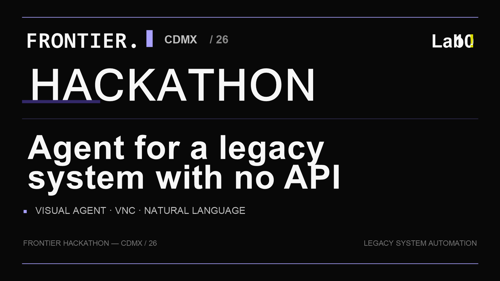
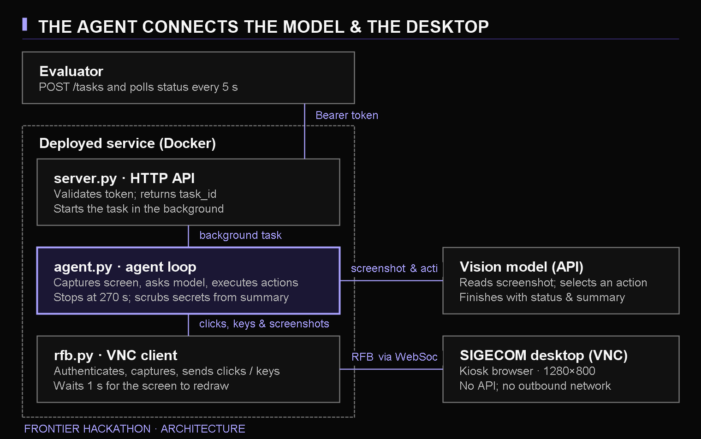

<p align="center">
  
</p>

<p align="center">
  
  
  <a href="https://github.com/ramonsesma/Frontier-Hackaton/releases/tag/v1.0.0"></a>
  <a href="LICENSE"></a>
</p>

# Agent for a legacy system with no API

An HTTP service whose agent operates an unseen management system the way a new employee would:
it looks at the screen and uses mouse and keyboard over VNC. It receives a task in natural
language, works on it in the background and reports a final status and a summary.

- Design document: [`docs/DESIGN.md`](docs/DESIGN.md)
- Architecture diagram: [`docs/arquitectura.png`](docs/arquitectura.png)



## Demo

The service accepts a natural-language task, starts the visual agent in the background, and returns a task ID immediately. The agent then operates the target desktop over VNC and publishes a final status and summary.

```bash
curl -X POST http://localhost:8080/tasks \
  -H "Authorization: Bearer $TEAM_TOKEN" \
  -H "Content-Type: application/json" \
  -d '{
    "tarea": "Create a client record for Ada Lovelace",
    "escritorio": {
      "url": "wss://example.com/websockify",
      "password": "<desktop password>"
    }
  }'
```

Use `GET /tasks/{task_id}` to retrieve the final status and summary. A live-demo recording can be added here when a non-sensitive capture is available.

## How it works

1. `POST /tasks` receives the task and the desktop (`wss://.../websockify` URL and password) and
   returns a `task_id` immediately.
2. `agent.py` connects to the desktop through `rfb.py` (a minimal RFB/VNC client written for this
   project) and loops: screenshot, model decision, actions, new screenshot.
3. The model finishes with a `finish` call carrying the status (`terminada` / `fallida`), a summary
   and, for questions, the answer. The summary gets a `respuesta: <value>` line when it is a question.
4. The desktop password and the service secrets are replaced in the summary before it is published.
5. `GET /tasks/{task_id}` returns `{"estado": "en_curso" | "terminada" | "fallida", "resumen": "..."}`.

A task is stopped at 270 s counted from the moment the request arrives (the evaluator cuts at 300 s),
and the VNC connection is closed as soon as the final status is reported. Only one agent runs per
desktop: a new task for the same desktop cancels the previous one, and an identical task that is
still running is not started twice.

## Entrypoint

Docker:

```bash
docker build -t desktop-agent .
docker run -p 8080:8080 \
  -e TEAM_TOKEN=<team token> \
  -e OPENROUTER_API_KEY=<model key> \
  desktop-agent
```

Without Docker (Python 3.12):

```bash
pip install -r requirements.txt
TEAM_TOKEN=<team token> OPENROUTER_API_KEY=<model key> uvicorn server:app --host 0.0.0.0 --port 8080
```

Every call needs `Authorization: Bearer <TEAM_TOKEN>`.

| Endpoint | What it does |
| --- | --- |
| `GET /health` | `{"ok": true}` when the service is ready |
| `POST /tasks` | Body: `{"tarea": "...", "escritorio": {"url": "wss://...", "password": "..."}}`. Returns `{"task_id": "..."}` |
| `GET /tasks/{task_id}` | `{"estado": "...", "resumen": "..."}` |

## Configuration

| Variable | Purpose | Default |
| --- | --- | --- |
| `TEAM_TOKEN` | Bearer token; without it every call returns 401 | required |
| `OPENROUTER_API_KEY` | Model access through OpenRouter | required |
| `AGENT_MODEL` | OpenRouter model id that chooses the actions (must accept images and tools) | `anthropic/claude-sonnet-4.5` |
| `LLM_BASE_URL` | OpenAI-compatible endpoint | `https://openrouter.ai/api/v1` |
| `MAX_STEPS` | Cap of model calls per task | `80` |
| `TASK_HARD_LIMIT_S` | Hard limit per task, in seconds | `270` |
| `TASK_WARN_S` | When the model is told to wrap up | `210` |
| `PORT` | Port inside the container | `8080` |

## Tests

```bash
pip install -r requirements.txt   # httpx, needed by the service tests, comes with `openai`
python test_rfb.py     # VNC client against a simulated server
python test_server.py  # per-desktop locking, cancellation, duplicates, late start, 401 on bad tokens
python test_agent.py   # agent loop with a fake model and desktop: actions, secret scrubbing,
                       # model-error retries, chained actions
```

None of them needs network, an API key or a real desktop. They do **not** exercise the real model or
the real app: that was measured separately (see Status).

## Try it without a desktop

```bash
TEAM_TOKEN=test uvicorn server:app --port 8080 &
curl -H "Authorization: Bearer test" http://localhost:8080/health   # {"ok":true}
curl http://localhost:8080/health                                    # 401
```

Running the full agent needs an OpenRouter key and a VNC desktop (`wss://.../websockify` plus its
password); neither is in this repository.

## Status

- Unit tests (no network): the RFB client against a simulated server, the agent loop with a fake model
  and desktop, and the service's per-desktop locking.
- Run against a real desktop with the real model on the 5 practice tasks:
  - Original theme: 13 runs, 12 pass. The one failure was on an earlier build, with an unknown cause
    (no step logs then).
  - New theme (version 4.2, see below): two rounds of the 5 tasks, 10 of 10 pass. Slowest run 205 s in
    the first round and 121 s in the second (limit 270 s).
- Not verified: any app other than the practice app, cost per task, the model-error retries against the
  real API (only tested with a fake model), and the event's validation runs. Details and risks are in
  the design document.

### Incident: the client changed the app's theme

The client updated the app to version 4.2 without notice. A pop-up "Novedades de la versión 4.2" opens
with the app, the action bar moved to the right, buttons have new names, and forms are now applied
without closing.

- What we found: the agent chooses each click from the screenshot and has no hard-coded labels or
  positions, so moved buttons and renamed labels did not need code. Two assumptions did break down:
  nothing told it what to do with a pop-up on opening, and a form that stays open after "Aplicar" can look
  like a failed save and be saved twice, which would duplicate or change more than asked.
- What we changed (prompt only): close informational pop-ups first; identify controls by function and
  on-screen text, not by position; press apply once per set of changes and read the success message.
- Evidence (step logs on the deployed service): in the runs read in detail, the pop-up is closed in
  step 1 (E1 and E3 in the first round, E1 in the second), and the create-client form was applied once.
  The app's own checks report no duplicates and no actions outside the task in all 10 runs. We did not
  read the step logs of E2, E4 and E5.
- Later changes for speed, validated on the same 5 tasks: finish as soon as the app confirms a save
  instead of searching the record again, count rows once per page, and retry transient model errors.
  The speed-up came from the shorter verification and the single count; in the run read in detail
  the model still issued one action per step, so chaining actions had no visible effect.
- Trade-off: with the shorter checks the agent, in the one run we read, searched for an existing client by
  tax id only and not also by name, so a same-name record with another id would be less likely to be seen.

### After the event: validation run and fixes

In the event's validation run (an unseen clinic app) the agent sent 34 tasks to completion: 23 reported
`terminada`, 11 `fallida`, 6 of them by running out of the 270 s limit. How the judge scored them is not
known to us. Problems seen in the logs, and the small fixes made afterwards:

| Problem seen | Fix (in `agent.py`) |
| --- | --- |
| A task asked to copy an integration key shown on screen; the key ended up in the summary | Prompt rule: never write on-screen secrets; fail the task saying where it is |
| A numeric answer used thousands separators (`2.275.000`) | Prompt rule plus `norm_respuesta` strips clear separators |
| "No export button" reported after a short look | Prompt rule: check menus and other names before saying a function is missing |
| The model sent `"378, 275"` in one coordinate field and the click failed | `coord` / `xy` accept it |

These fixes are **tested only with the fake model** (`test_agent.py`). They were not run against a real
desktop or the real model, and the deployed service was not updated (it still runs commit 70401b4).
Not changed: the time-outs (model latency, about 6 s per step) and a case where the agent cancelled a
pending appointment because the app asked for it, which may count as an extra change.


No external tool that operates desktops is used; the VNC client is implemented in `rfb.py`.
